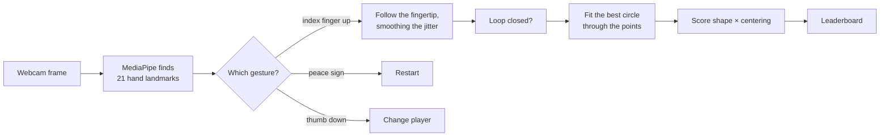
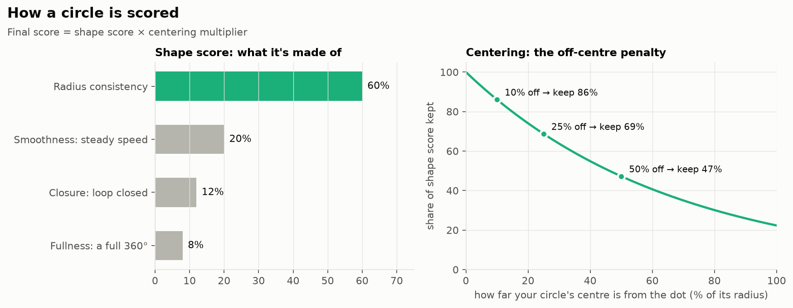

# Perfect Circle 🟢

**Draw a circle in the air with your finger and find out how perfect it is.**

Your webcam tracks your hand in real time. Raise your index finger, trace a circle around the green dot, close the loop, and the game scores your circle out of 100, with a leaderboard to beat your friends.

> 🎓 Built for the IDSA course project at MPSTME, NMIMS.

---

## Why it's more than a game

Perfect Circle uses the same building blocks as serious hand-tracking products: find the hand in a camera image, follow a fingertip, clean up the jittery signal, and judge the shape it drew.

| Where the same idea shows up | What it does there |
|---|---|
| 🖐️ **Touch-free screens** | Kiosks and hospital displays you control by pointing, without touching a shared screen. |
| 🥽 **AR and VR** | Headsets track your hands so you can grab and draw in the air. |
| 🩺 **Motor-skill exercises** | Tracing shapes is a common steadiness exercise; a score shows progress over time. |
| 🧑‍🏫 **Teaching computer vision** | A fun, visual way to show hand landmarks, smoothing and curve fitting in action. |

---

## How it works



- **Hand tracking:** MediaPipe finds 21 points on your hand in each frame, and the game reads gestures from which fingers are raised.
- **Smoothing:** raw fingertip positions jitter, so they are smoothed as you draw (exponential smoothing), and the finished path is rounded off (Chaikin smoothing).
- **Circle fitting:** the **Taubin fit**, a classic algebraic method, finds the mathematically best circle through your points. It is more accurate than averaging the points, especially for wobbly or partial loops.

## How you're scored



**Shape score** (how circular is it?), weighted:
- **Radius consistency, 60%:** are all your points the same distance from the fitted centre?
- **Smoothness, 20%:** did your finger move round at a steady speed?
- **Closure, 12%:** did the end meet the start?
- **Fullness, 8%:** did you go all the way round?

**Centering multiplier:** the further your circle's centre is from the green dot, the more of the shape score you lose. 10% of the radius off keeps 86%; half a radius off keeps 47%.

```
Final score = shape score × centering multiplier
```

| Score | Tier |
|---|---|
| 90 – 100 | Perfect Circle 🥇 |
| 78 – 89 | Legendary Circle |
| 65 – 77 | Master Circle |
| 50 – 64 | Great Circle |
| 30 – 49 | Decent Attempt |
| 0 – 29 | Keep Practicing |

---

## Run it

Needs Python **3.9 – 3.12** (MediaPipe can have trouble on 3.13) and a webcam.

```bash
git clone https://github.com/figureitoutkrish/PerfectCircleAppwithPYTHON.git
cd PerfectCircleAppwithPYTHON
python -m venv venv
source venv/bin/activate        # Windows: venv\Scripts\activate
pip install -r requirements.txt
python perfect_circle.py
```

> ⚠️ Use `opencv-python-headless`, not `opencv-python`. On macOS the regular version bundles its own SDL2, which crashes alongside Pygame. `requirements.txt` already installs the right one.

On newer MediaPipe versions, the first run downloads a small hand-landmark model (about 8 MB). This only happens once.

### Controls

| Gesture | Action |
|---|---|
| ☝️ **Index finger only** | Start drawing |
| Draw in the air | Trace a circle around the green dot |
| Close the loop | Bring your finger back near the start to submit |
| ✌️ **Peace sign** | Play again, or cancel the drawing |
| 👎 **Thumb down** | Back to the player-name screen |

**Tips:** draw slowly and steadily, keep the green dot inside your circle, and face a light source (not a bright window).

---

## Troubleshooting

**Crashes on start with SDL2 errors:** you have `opencv-python` installed next to Pygame.
```bash
pip uninstall opencv-python -y
pip install opencv-python-headless
```

**`module 'mediapipe' has no attribute 'solutions'`:** you have MediaPipe 0.10 or newer. The game handles this, but needs internet on the first run to download the model.

**Webcam not found:** close other apps using the camera (Zoom, FaceTime). On macOS, allow camera access for Terminal or your editor in System Settings → Privacy & Security → Camera.

**Hand not detected:** improve the lighting, keep your hand within arm's reach, and avoid a busy or dark background.

**Low FPS (under 20):** close other apps, or lower the camera resolution from `1280 × 720` to `640 × 480` in `perfect_circle.py`.

## Files

```
perfect_circle.py           the game
perfect_circle_scores.json  the leaderboard (created on the first score)
requirements.txt            the three libraries it needs
```

**Built with:** Python, MediaPipe (hand tracking), OpenCV (camera), Pygame (window and drawing).

---

Built by [Krish Viramgama](https://github.com/figureitoutkrish).
